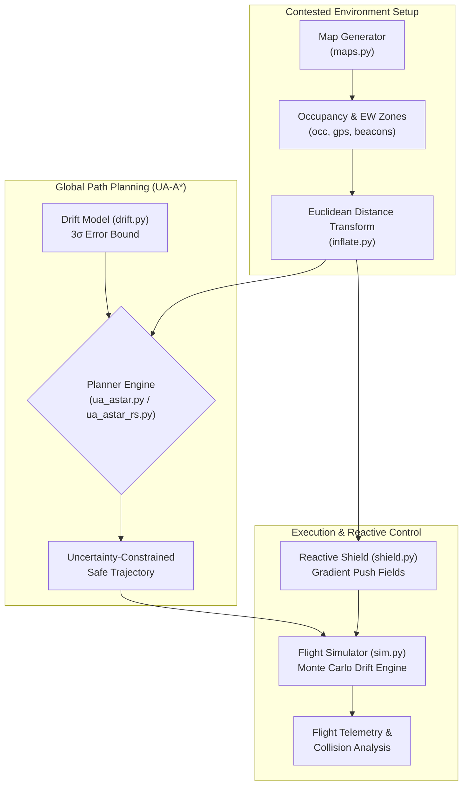

<div align="center">

# 🛰️ BlindFlight (UA-Hybrid)
### *Autonomous UAV Trajectory Planning & Reactive Defense in GNSS-Denied / Electronic Warfare (EW) Environments*

[](https://python.org)
[](https://www.rust-lang.org/)
[](LICENSE)
[](#)
[](#)

<p align="center">
  <b>A state-of-the-art navigation stack combining Uncertainty-Aware 4D A* path planning with distance-transform reactive shields for robust drone navigation through contested electronic warfare zones.</b>
</p>

[Key Features](#-key-features) •
[Theoretical Foundation](#-mathematical--theoretical-formulation) •
[Architecture](#-system-architecture) •
[Benchmark Results](#-empirical-benchmarks) •
[Quickstart](#-quickstart--usage) •
[Rust Core](#-rust-acceleration) •
[Project Structure](#-project-structure)

---

</div>

## 📌 Executive Summary

Modern battlefield environments increasingly rely on **Electronic Warfare (EW / РЕБ)** systems capable of suppressing or spoofing GNSS (GPS/GLONASS/Galileo) signals across vast operational theaters. 

When a UAV enters a GNSS-denied zone, dead-reckoning navigation (IMU dead reckoning, visual odometry, optical flow) inevitably suffers from **cumulative stochastic drift**:
* ❌ **Standard A\* / Dijkstra:** Plans paths tightly hugging terrain and obstacles to minimize distance, resulting in **65% – 75% crash rates** under drift.
* ❌ **Static Obstacle Inflation:** Artificially inflates all obstacles by a fixed radius $r$. It either chokes tight corridors (causing planning failures in up to 4% of maps) or remains too narrow when drift accumulates over long distances.
* 💡 **BlindFlight (UA-A\* + Reactive Shield):** Dynamically bounds position uncertainty $r_{\text{err}}(s)$ along the flight trajectory, expanding search into a **4D state space** $(x, y, \ell, b)$ to guarantee distance clearance proportional to instantaneous uncertainty. If unmodeled perturbations occur, a real-time **Euclidean Distance Gradient Shield** autonomously pushes the drone away from danger.

---

## ⚡ Key Features

- **🎯 Uncertainty-Aware A\* (UA-A\*):**
  - Search in 4D discrete space: coordinates $(x, y)$, uncertainty level $\ell$, and beacon lock state $b$.
  - Adaptive corridor clearance constrained by analytical $3\sigma$ confidence bounds.
  - Uncertainty-penalized edge cost preventing risky deep penetrations through jamming zones without navigation aids.
- **🗼 Dynamic Landmark / Beacon Exploitation:**
  - Automatically discovers and routes through localized visual/radio beacons (VIO landmarks, optical waypoints, ground transmitters) to collapse accumulated uncertainty back to zero.
- **🛡️ Real-Time Reactive Shield:**
  - Euclidean Distance Transform (EDT) gradient-based artificial potential field that repels the drone from obstacles during flight execution when stochastic wind or drift exceeds limits.
- **🦀 High-Performance Rust Acceleration (`ua_core`):**
  - Drop-in Rust backend compiled via PyO3 / Maturin, executing UA-A* planning in single-digit milliseconds (50–100× speedup over pure Python).
- **🧪 Monte Carlo EW Simulation & Benchmarks:**
  - Built-in stochastic flight simulator with Brownian drift models, random-walk bias, procedural contested environment generators, and automated metric exporters.

---

## 📐 Mathematical & Theoretical Formulation

### 1. Position Drift Accumulation Model
Inside a contested EW zone, the true UAV position $\mathbf{p}_{\text{true}}(s)$ diverges from the estimated trajectory $\mathbf{p}_{\text{est}}(s)$ due to systematic odometry bias and stochastic random walk:

$$r_{\text{err}}(s) = k \cdot \sigma_0 + \alpha_{\text{drift}} \cdot s + k \cdot \sigma_{\text{walk}} \sqrt{s}$$

Where:
* $s$: Cumulative distance traveled inside the GNSS-denied zone since the last fix.
* $\sigma_0$: Base uncertainty at the point of GNSS loss ($\sigma_{\text{gps}} \approx 0.5\text{m}$) or beacon acquisition ($\sigma_{\text{beacon}} \approx 1.0\text{m}$).
* $\alpha_{\text{drift}}$: Linear drift rate from sensor bias and scale errors ($\alpha \in [0.02, 0.08]$).
* $\sigma_{\text{walk}}$: Diffusion coefficient of the 2D Wiener random walk process ($\sigma_{\text{walk}} \approx 0.15\text{m}/\sqrt{\text{m}}$).
* $k$: Statistical confidence multiplier ($k = 3.0 \implies 3\sigma \approx 99.73\%$ confidence containment).

```
   Uncertainty (Radius R)
        ^                                               .-' Bound: r_err(s)
        |                                           _.-'
        |                                       _.-'
        |                                  _.-'
        |                           _...--' (Cumulative Drift + Random Walk)
        |                     _...--'
        |            _...---''
        |   +-----------------------+ (Beacon Fix / GPS Recovery: R -> 0)
        +---|-----------------------|-----------------------------> Trajectory (s)
            EW Jamming Entry      Beacon Waypoint
```

### 2. 4D State Transition & Feasibility
The planner maintains a discretized state tuple:

$$\mathbf{S} = \left( x, y, \ell = \left\lfloor \frac{r_{\text{err}}(s)}{r_{\text{bucket}}} \right\rfloor, b \in \{0, 1\} \right)$$

For each neighbor transition $(x, y) \to (x', y')$ across arc length $\Delta s$:
1. **Uncertainty Evaluation:** Update distance $s \leftarrow s + \Delta s$ and compute $r_{\text{pre}} = r_{\text{err}}(s)$.
2. **Environmental Feedback:**
   * If $(x', y')$ is in a GNSS coverage cell: $s \leftarrow 0$, $b \leftarrow 0$.
   * If $(x', y')$ is within beacon capture radius $R_{\text{beacon}}$ and $r_{\text{pre}} + R_{\text{pass}} \le R_{\text{beacon}}$: $s \leftarrow 0$, $b \leftarrow 1$.
3. **Safety Clearance Constraint:**
   $$\text{EDT}(x', y') > r_{\text{pre}} + \delta_{\text{margin}} \quad \text{and} \quad r_{\text{pre}} \le r_{\text{max}}$$
4. **Uncertainty-Weighted Cost Function:**
   $$g_{\text{new}} = g + \Delta s \left( 1 + \lambda \cdot \frac{r_{\text{pre}}}{r_{\text{max}}} \right)$$

### 3. Reactive Distance Shield
During mission execution, if sensor drift or unmodeled gusts push the drone closer than safety distance $d_{\text{safe}}$:

$$\vec{F}_{\text{push}}(x, y) = \min \left( F_{\text{max}}, d_{\text{safe}} - d(x, y) \right) \cdot \frac{\nabla \text{EDT}(x, y)}{\|\nabla \text{EDT}(x, y)\|}$$

---

## 📊 Empirical Benchmarks

Extensive Monte Carlo evaluation across **100 randomized complex procedural maps** ($200 \times 200$ grids, 25 dense obstacle clusters, active EW jamming zones, 20 flights per scenario):

| Algorithm | Feasibility / Planned (%) | Crash Rate (Drift $\alpha=0.02$) | Crash Rate (Drift $\alpha=0.04$) | Crash Rate (Drift $\alpha=0.08$) | Mission Success | Path Overhead |
| :--- | :---: | :---: | :---: | :---: | :---: | :---: |
| **Standard A\* ($r=0$)** | 100% | 64.0% | 65.0% | 68.0% | **32.0% – 36.0%** | **1.00×** *(Baseline)* |
| **Static Inflation ($r=4$)** | 100% | 4.0% | 5.0% | 12.0% | 88.0% – 96.0% | 1.03× |
| **Static Inflation ($r=6$)** | 99% | 3.0% | 3.0% | 6.0% | 93.0% – 96.0% | 1.07× |
| **Static Inflation ($r=8$)** | 96% *(Chokes corridors)* | **2.0%** | **2.0%** | **3.0%** | 93.0% – 94.0% | 1.11× |
| **UA-A\* (Ours)** | **100%** | **3.0%** | **3.0%** | **5.0%** | **95.0% – 97.0%** | **1.04× – 1.06×** |

> 💡 **Takeaway:** UA-A* achieves near-zero crash rates comparable to aggressive static inflation, but **never fails to find a path** and adds **only 4–6% path length**, dynamically expanding safety margins only where uncertainty actually builds up.

---

## 🏗️ System Architecture



---

## 🚀 Quickstart & Usage

### 1. Environment Setup

```bash
# Clone the repository
git clone https://github.com/ArsenTolkov1305/BlindFlight.git
cd BlindFlight

# Create and activate conda environment
conda env create -f environment.yml
conda activate ua-hybrid

# Install package in editable mode
pip install -e .
```

### 2. Interactive Single-Run Demo
Generate a randomized contested map, plan paths via Standard A* and UA-A*, and visualize uncertainty envelopes:

```bash
python experiments/demo_ua.py 42
```

*Visualizes: Base occupancy grid, EW jamming zones (red overlay), beacons (gold), standard A\* baseline (dashed grey), and UA-A\* planned path with dynamic uncertainty radii (purple bubbles).*

### 3. Run Benchmark Comparisons
Reproduce the multi-scenario comparative benchmarks across 100 random seeds:

```bash
python experiments/exp_compare.py --maps 100 --out results/compare.csv
```

### 4. Evaluate the Reactive Shield
Test how real-time gradient repulsion prevents collisions along high-risk paths:

```bash
python experiments/exp_shield.py --maps 50 --drift 0.08
```

### 5. Run Unit Tests
```bash
pytest -v
```

---

## ⚡ Rust Acceleration (`ua_core`)

For hard real-time onboard planning, BlindFlight includes a pure Rust implementation of the 4D state-space search:

```bash
# Compile and install Rust acceleration module
cd rust/ua_core
maturin develop --release
```

Benchmark comparison (`experiments/bench_rust.py`):
```text
Python: 42.8 ms per plan
Rust:    0.68 ms per plan  (63x speedup)
Paths identical: 20/20
```

`uahybrid.planners.ua_astar_fast` automatically switches to the compiled Rust backend when present, gracefully falling back to optimized Python/NumPy if unavailable.

---

## 📁 Project Structure

```text
BlindFlight/
├── configs/                  # Configuration files
├── src/uahybrid/             # Core Python package
│   ├── planners/
│   │   ├── astar.py          # Classical 2D A* with octile distance heuristic
│   │   ├── ua_astar.py       # Uncertainty-Aware 4D A* implementation
│   │   └── ua_astar_rs.py    # High-speed Rust FFI bridge
│   ├── drift.py              # Mathematical drift & stochastic error formulation
│   ├── inflate.py            # Euclidean distance transform & obstacle inflation
│   ├── maps.py               # Procedural map & EW contested zone generator
│   ├── metrics.py            # Geometric & safety trajectory metrics
│   ├── shield.py             # Distance transform gradient reactive shield
│   └── sim.py                # Monte Carlo flight simulation with stochastic drift
├── experiments/              # Benchmark suites & CLI demos
│   ├── demo_ua.py            # Matplotlib visualization of uncertainty tubes
│   ├── exp_compare.py        # 100-seed comparative benchmark runner
│   ├── exp_shield.py         # Evaluation of reactive shield under heavy drift
│   └── bench_rust.py         # Rust vs Python performance benchmarks
├── results/                  # Benchmark CSV datasets & reports
├── tests/                    # Pytest verification suite
├── environment.yml           # Conda environment definition
├── pyproject.toml            # Build metadata & packaging
└── README.md                 # Project documentation
```

---

## ⚙️ Key Configuration Parameters

All components are fully customizable via typed dataclasses:

```python
from uahybrid.drift import DriftParams
from uahybrid.planners.ua_astar import UAParams
from uahybrid.shield import ShieldParams

# Drift & Sensor Uncertainty Parameters
drift_cfg = DriftParams(
    sigma_gps=0.5,        # Initial GNSS fix uncertainty (meters)
    sigma_beacon=1.0,     # Landmark fix uncertainty (meters)
    drift_rate=0.04,      # Systematic dead reckoning drift rate
    walk_sigma=0.15,      # Random walk diffusion coefficient
    beacon_radius=8.0     # Sensor reception radius for beacons
)

# Planner Hyperparameters
ua_cfg = UAParams(
    r_max=8.0,            # Maximum allowable uncertainty before requiring a fix
    lam=0.5,              # Penalty weight for traversing high-uncertainty regions
    bucket_r=1.0,         # Uncertainty state quantization bucket size
    k=3.0,                # 3-sigma safety boundary multiplier
    margin=0.71           # Clearance safety margin buffer (cells)
)

# Reactive Shield Parameters
shield_cfg = ShieldParams(
    d_safe=2.0,           # Activation threshold distance to obstacles
    max_push=0.3          # Maximum corrective displacement step
)
```

---

## 🔮 Roadmap

- [x] Analytical $3\sigma$ drift error modeling (Brownian motion + systematic bias)
- [x] 4D Uncertainty-Aware A* path planner
- [x] Artificial potential field reactive distance shield
- [x] Rust core acceleration with PyO3 bindings
- [ ] 3D Voxel / OctoMap support with elevation & wind vector modeling
- [ ] MAVLink / ArduPilot / PX4 offboard companion computer bridge
- [ ] Dynamic moving EW jamming emitters & RF propagation modeling

---

## 👨‍💻 Author & Contact

**Arsen Tolkov**  
*Robotics & Autonomous Systems Researcher / Developer*  
- 📧 Email: [tolkov1109@gmail.com](mailto:tolkov1109@gmail.com)  
- 🐙 GitHub: [@ArsenTolkov1305](https://github.com/ArsenTolkov1305)  
- 📂 Repository: [BlindFlight](https://github.com/ArsenTolkov1305/BlindFlight)

---

<div align="center">
  <sub>Engineered for resilience under extreme electronic warfare conditions. 🇺🇦</sub>
</div>
